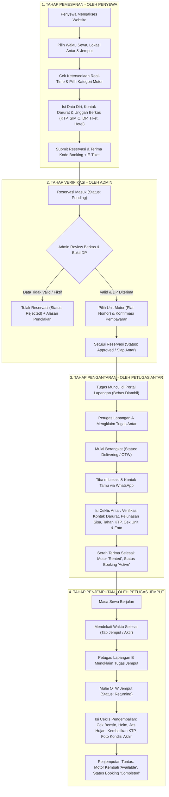
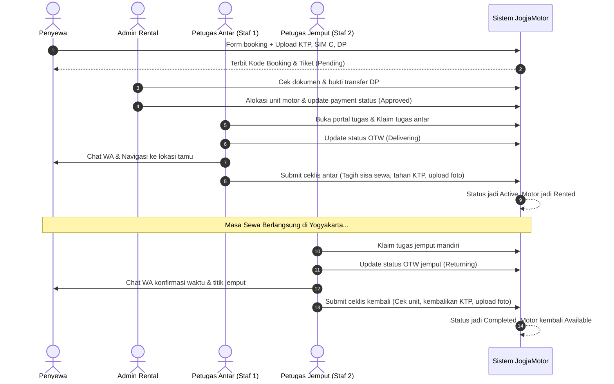
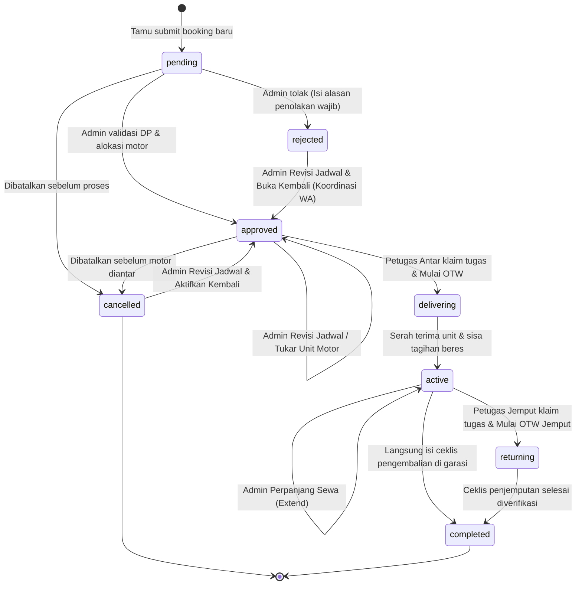

# DOKUMEN ALUR BISNIS & STANDAR OPERASIONAL PROSEDUR (SOP)
## SISTEM INFORMASI RENTAL MOTOR JOGJAMOTOR

---

## 1. PENDAHULUAN & RINGKASAN EKSEKUTIF

Sistem Informasi **JogjaMotor** dirancang untuk mendigitalisasi dan mengotomatiskan seluruh siklus bisnis persewaan sepeda motor di Daerah Istimewa Yogyakarta. Sistem ini menghubungkan 3 aktor utama:
1. **Penyewa (Wisatawan / Pelanggan Publik)**: Menikmati pemesanan instan, verifikasi ketersediaan armada real-time, transparansi biaya, dan kemudahan lacak tiket pemesanan tanpa perlu registrasi akun berbelit.
2. **Admin Pengelola (Back-Office & Manajemen)**: Bertanggung jawab melakukan validasi identitas & pembayaran uang muka (DP), mengalokasikan unit motor, memantau armada, dan mengelola master data tanpa dibebani plotting manual kurir.
3. **Petugas Lapangan / Kurir (Mobile Portal Lapangan)**: Memiliki hak mandiri (*self-service*) untuk melihat, memilih, dan mengklaim tugas pengantaran serta penjemputan unit secara terpisah (petugas antar dan petugas jemput independen), dilengkapi ceklis serah terima digital yang meminimalisir risiko penipuan/kehilangan armada.

---

## 2. DIAGRAM ALUR BISNIS END-TO-END

---

## 3. MATRIKS PERAN & HAK AKSES (RACI)

| Aktivitas / Fitur | Penyewa (Publik) | Admin Pengelola | Petugas Lapangan |
| :--- | :---: | :---: | :---: |
| **Cek Ketersediaan & Biaya Real-time** | **R** (Pelaku) | I (Info) | I (Info) |
| **Reservasi & Unggah Berkas Jaminan** | **R** (Pelaku) | I (Info) | - |
| **Lacak Status Pesanan (E-Tiket Digital)** | **R** (Pelaku) | I (Info) | I (Info) |
| **Hubungi CS Admin via WhatsApp** | **R** (Pelaku) | **A** (Penerima) | - |
| **Verifikasi Pembayaran DP & Dokumen** | I (Info) | **R / A** (Pengambil Keputusan) | I (Info) |
| **Alokasi Unit Motor (Plat Nomor)** | I (Menerima unit) | **R / A** (Penentu alokasi) | I (Melihat plat) |
| **Persetujuan / Penolakan Reservasi** | I (Menerima notifikasi) | **R / A** (Keputusan Mutlak) | I (Melihat tugas siap) |
| **Klaim Tugas Antar (Self-Service)** | - | I (Monitoring read-only) | **R** (Pengambil tugas mandiri) |
| **Klaim Tugas Jemput (Self-Service)** | - | I (Monitoring read-only) | **R** (Pengambil tugas mandiri) |
| **Verifikasi Kontak Darurat di Lokasi** | C (Diperiksa) | I (Melihat hasil) | **R** (Wajib memverifikasi) |
| **Penagihan Sisa Biaya Sewa di Lokasi** | C (Membayar) | I (Melihat laporan) | **R** (Menagih & konfirmasi) |
| **Penahanan KTP Fisik Jaminan** | C (Menyerahkan) | I (Melihat status) | **R** (Menyimpan di map jaminan) |
| **Dokumentasi Foto Ceklis Antar & Jemput** | - | I (Audit & cek berkas) | **R** (Memotret unit di lokasi) |
| **Kelola Master Motor, Tarif & Pengguna** | - | **R / A** (Administrator) | - |

> **Keterangan RACI**:
> - **R (Responsible)**: Pihak yang mengerjakan aktivitas tersebut.
> - **A (Accountable)**: Pihak yang mengambil keputusan dan bertanggung jawab penuh.
> - **C (Consulted)**: Pihak yang dimintai data/persetujuan dua arah.
> - **I (Informed)**: Pihak yang menerima pembaruan informasi secara transparan.

---

## 4. PENJELASAN ALUR BISNIS RINCI (STEP-BY-STEP)

### FASE 1: PEMESANAN OLEH WISATAWAN / PENYEWA
1. **Penentuan Jadwal & Durasi**:
   - Penyewa menentukan tanggal & jam mulai serta tanggal & jam pengembalian.
   - Sistem secara otomatis menghitung durasi pokok hari sewa (24 jam) serta kelebihan jam (*overtime*).
2. **Pemilihan Titik Antar & Jemput**:
   - Penyewa memilih titik antar (misal Stasiun Tugu, Stasiun Lempuyangan, Kantor Pusat, atau Hotel di zona tertentu).
   - Biaya antar dan jemput dihitung transparan sesuai zona tarif yang dipilih.
3. **Cek Armada Real-Time**:
   - Sistem mengecek unit yang tidak sedang disewa, tidak dalam status *maintenance*, dan tidak bentrok dengan reservasi yang telah disetujui pada rentang jam tersebut.
4. **Pengisian Data & Pengunggahan Berkas**:
   - Penyewa mengisi data identitas, akun media sosial, nomor WhatsApp, serta **Kontak Darurat** (Nama, hubungan keluarga/teman, nomor WhatsApp).
   - Penyewa mengunggah foto Bukti Transfer DP (minimal Rp 50.000), KTP, SIM C, serta dokumen pendukung (tiket kereta/pesawat & voucher hotel).
   - Di sisi browser penyewa, berkas otomatis divalidasi maksimal 5MB dan dikompresi agar hemat kuota dan server tetap ringan.
5. **Penerbitan E-Tiket**:
   - Reservasi tersimpan dengan status `pending` (*Menunggu Verifikasi*).
   - Penyewa mendapatkan link E-Tiket digital yang bisa dicek setiap saat di menu **Cek Pesanan**.

---

### FASE 2: VERIFIKASI ADMIN & SISTEM PEMBAYARAN 2 PINTU
1. **Pemeriksaan Dokumen & Verifikasi Pembayaran Masuk (Pintu 1)**:
   - Admin membuka menu `Kelola Reservasi` (`/admin/bookings`).
   - Admin memeriksa keaslian bukti transfer DP dan kesesuaian dokumen jaminan (KTP & SIM C).
   - **Prinsip Bebas Utak-Atik Status Bayar**: Di halaman admin tidak ada dropdown status bayar manual. Admin tidak memilih opsi "lunas" atau "belum", melainkan hanya mengonfirmasi apakah uang muka (DP) sudah masuk ke rekening.
2. **Koreksi Nominal DP Jika Tidak Sesuai**:
   - Jika terjadi kasus nominal transfer riil berbeda dengan klaim penyewa (misal penyewa mentransfer **Rp 10.000** namun di form pemesanan menulis DP **Rp 50.000**):
     - Admin mengonfirmasi kepada penyewa via WhatsApp apakah pemesanan ingin tetap dilanjutkan.
     - Jika penyewa setuju, admin mengubah kolom **Nominal DP Masuk** menjadi **Rp 10.000**, lalu menyetujui pesanan.
     - Sistem secara otomatis menghitung ulang sisa tagihan:
       $$\text{Sisa Tagihan} = \text{Total Biaya} - \text{Nominal DP Masuk}$$
       *(Contoh: Total Rp 100.000 - DP Rp 10.000 = **Sisa Tagihan Rp 90.000**)*.
     - Sisa tagihan Rp 90.000 ini otomatis tersinkronisasi ke portal mobile petugas lapangan untuk ditagihkan saat serah terima.
   - Admin juga dapat menyesuaikan nominal DP kapan saja melalui modal **Koreksi Nominal DP Masuk**.
3. **Aksi Kontekstual Berbasis Status (*Guided Actions*)**:
   - **Status `pending` (Reservasi Baru)**:
     - Form Persetujuan: Admin memilih unit motor konkret (plat nomor) dan memasukkan/mengonfirmasi nominal DP yang masuk. Tombol *Setujui Reservasi & Alokasikan Unit* langsung mengaktifkan pesanan ke status `approved` dan mencatat pembayaran DP terkonfirmasi (`dp_approved`).
     - Tombol **Tolak Reservasi**: Membuka modal dengan alasan penolakan wajib dan template cepat (*Unit Penuh*, *KTP/SIM Buram*, *Bukti Transfer Belum Masuk*, *Luar Jangkauan*). Alasan ini langsung tampil transparan di tiket penyewa.
   - **Status `rejected` (Reservasi Ditolak)**:
     - Menampilkan alasan penolakan yang telah dicatat.
     - **Fitur Revisi Jadwal & Buka Kembali**: Jika penyewa berkoordinasi via WhatsApp dan meminta ganti hari sewa atau ganti tipe motor, admin cukup mengklik tombol revisi untuk membuka modal jadwal baru. Saat disimpan, status otomatis berubah menjadi `approved` (Diterima).
   - **Status `approved` (Disetujui / Siap Antar)**:
     - Menampilkan plat unit motor dan ringkasan pembayaran 2 pintu: DP masuk terkonfirmasi admin & sisa tagihan yang harus ditagih petugas lapangan.
     - Tombol **Ubah Hari / Ganti Unit Motor** dan **Batalkan Reservasi**.
   - **Status `active` / `delivering`**:
     - Tombol **Perpanjang Sewa (Extend)** jika penyewa menambah durasi sewa di tengah jalan.
4. **Modal Revisi Jadwal & Kalkulator Real-Time**:
   - Admin dapat mengubah tanggal sewa, kategori, dan unit motor. Sistem otomatis menghitung ulang durasi sewa, tarif pokok, biaya overtime, total biaya, dan sisa tagihan secara real-time.
5. **Otomasi Antrean Kurir Lapangan**:
   - Seluruh reservasi yang disetujui otomatis masuk ke antrean tugas portal mobile lapangan tanpa perlu penugasan manual oleh admin.

---

### FASE 3: OPERASIONAL PENGANTARAN (SERAH TERIMA UNIT)
1. **Pengambilan Tugas Mandiri (*Self-Service Delivery Claim*)**:
   - Petugas lapangan login di ponsel mereka melalui `/staff/tasks`.
   - Di tab **Antar**, petugas melihat daftar antrean unit yang siap diantar dengan badge *"Bebas Diambil"*.
   - Petugas dapat mengklik tombol **Ambil Tugas** (mengklaim menjadi kurir pengantar) atau tombol **Ambil & OTW** (langsung jalan).
   - Kolom `delivery_staff_id` otomatis terikat ke ID petugas yang mengambil.
2. **Komunikasi dengan Tamu**:
   - Pada kartu tugas terdapat tombol sekali-klik **Chat Tamu via WhatsApp** dengan template sapaan resmi:
     > *"Halo Kak [Nama], saya dari Rental Motor Jogja. Saya bertugas mengantarkan motor [Tipe] (Plat: [Plat]) dengan kode booking [Kode] ke lokasi Kakak hari ini..."*
   - Terdapat tombol **Buka Maps** untuk langsung memandu navigasi kurir ke titik pengantaran.
3. **Pemeriksaan Fisik & Ceklis Serah Terima Lapangan**:
   - Petugas bertemu penyewa dan membuka formulir ceklis:
     1. **Verifikasi Kontak Darurat**: Menghubungi kontak darurat untuk memastikan benar mengenal penyewa.
     2. **Pelunasan Sisa Biaya Sewa**: Menagih sisa tagihan di lokasi (tunai atau transfer QRIS).
     3. **Penahanan Jaminan Identitas Fisik**: Menahan fisik KTP Asli penyewa.
     4. **Pengecekan Kelengkapan Motor**: Memeriksa volume bensin, menyerahkan 2 helm SNI bersih, jas hujan di bagasi, serta kunci & STNK asli.
     5. **Dokumentasi Foto**: Memotret unit dari sudut jelas dan foto serah terima unit bersama penyewa.
4. **Aktivasi Masa Sewa**:
   - Setelah formulir ceklis disubmit, status reservasi berubah menjadi `active` (*Sedang Disewa*) dan status motor berubah menjadi `rented`.

---

### FASE 4: OPERASIONAL PENJEMPUTAN (PENGEMBALIAN UNIT)
1. **Pemisahan Petugas Antar dan Petugas Jemput**:
   - Petugas yang menjemput motor **bisa orang yang berbeda** dari petugas yang mengantarkan motor di awal.
2. **Monitoring & Klaim Penjemputan (*Return Claim*)**:
   - Pada tab **Jemput**, seluruh reservasi yang mendekati waktu selesai muncul untuk dapat diklaim oleh petugas lapangan mana pun yang memiliki rute terdekat.
   - Petugas mengklik tombol **Ambil Tugas Jemput** atau **Mulai OTW Jemput**. Kolom `return_staff_id` otomatis terisi ID petugas penjemput.
3. **Pemeriksaan Fisik Pengembalian**:
   - Petugas tiba di lokasi pengembalian dan membuka formulir ceklis jemput:
     1. Memeriksa indikator bensin akhir.
     2. Memeriksa kelengkapan helm dan jas hujan yang dikembalikan.
     3. Menerima kunci & STNK asli.
     4. Mencatat jika ada goresan/kerusakan baru.
     5. Menyerahkan kembali KTP jaminan fisik asli kepada penyewa.
     6. Mengunggah foto dokumentasi kondisi akhir unit motor.
4. **Penyelesaian Transaksi**:
   - Setelah formulir disubmit, status reservasi menjadi `completed` (*Selesai*).
   - Status unit motor otomatis kembali menjadi `available` (*Tersedia*) dan siap disewakan kembali ke pelanggan berikutnya.

---

## 5. DIAGRAM SEQUENCE SIKLUS HIDUP TRANSAKSI

---

## 6. SIKLUS STATUS RESERVASI (FINITE STATE MACHINE)

---

## 7. FITUR MITIGASI RISIKO OPERASIONAL RENTAL MOTOR

1. **Pencegahan Kehilangan / Penggelapan Motor**:
   - Penahanan **KTP Asli Fisik** penyewa selama masa sewa berlangsung.
   - Wajib melampirkan foto tiket perjalanan (kereta/pesawat) & voucher hotel sebagai bukti valid wisatawan.
   - Verifikasi langsung **Kontak Darurat** (telepon/chat keluarga atau rekan kerja yang tidak ikut berlibur) sebelum motor dilepas.
2. **Pencegahan Fraud Finansial**:
   - Minimal pembayaran DP (Rp 50.000) diverifikasi langsung oleh Admin sebelum motor dialokasikan.
   - Di portal kurir, nominal sisa tagihan disorot dengan warna peringatan tegas agar kurir tidak lupa menagih pelunasan sebelum kunci motor diserahkan.
3. **Penyelesaian Sengketa Kerusakan Unit**:
   - Dokumentasi foto kondisi fisik awal saat serah terima dan foto saat pengembalian tersimpan permanen di sistem dengan tampilan 2 kolom berdampingan (*side-by-side comparison*) untuk membuktikan riwayat goresan atau kerusakan baru.
4. **Efisiensi Armada & Kepuasan Tamu**:
   - Staf penjemput tidak harus sama dengan staf pengantar, memungkinkan pembagian tugas fleksibel berbasis rute terdekat.
   - Ketika ceklis pengembalian disubmit di lapangan, unit motor langsung berstatus `available` secara instan di database, sehingga pelanggan lain di website dapat langsung menyewanya tanpa jeda administrasi manual.

---
*Dokumen ini merupakan panduan resmi standar operasional sistem informasi JogjaMotor. Versi 2.0 - Terakhir diperbarui Oktober 2026.*
