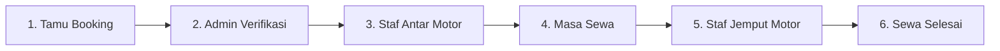

# 📖 Panduan Singkat Pemakaian — JogjaMotor

Panduan praktis dan ringkas operasional sistem persewaan motor **JogjaMotor** untuk Pelanggan, Admin, dan Staf Lapangan.

---

## 🎯 1. Alur Singkat Pemakaian

---

## 🛵 2. Panduan untuk Tamu / Pelanggan (Publik)

1. **Pilih Jadwal & Lokasi**:
   - Buka halaman utama website.
   - Pilih tanggal & jam sewa serta tanggal & jam pengembalian (kelipatan 24 jam).
   - Tentukan lokasi pengantaran dan penjemputan (bisa gratis seperti Stasiun Tugu/Lempuyangan, atau zona ongkir khusus).
2. **Pilih Motor & Lengkapi Data**:
   - Pilih tipe motor yang tersedia.
   - Masukkan identitas diri, nomor WhatsApp aktif, kontak darurat keluarga, dan berkas jaminan (KTP & SIM C).
   - Transfer DP minimal sesuai ketentuan dan unggah bukti transfer.
3. **Simpan Tiket Booking**:
   - Setelah reservasi berhasil dikirim, Anda akan mendapatkan **Kode Booking**.
   - Buka halaman **Cek Booking** untuk memantau status verifikasi, identitas kurir yang bertugas, nomor plat motor, serta status penjemputan.

---

## 🖥️ 3. Panduan untuk Admin (Back-Office)

### A. Memproses Pesanan Masuk (Booking)
1. Buka menu **Daftar Booking** (`/admin/bookings`).
2. Pesanan baru berstatus **Menunggu Verifikasi (Pending)**:
   - Klik **Detail** pada pesanan.
   - Cek keabsahan data KTP, SIM C, dan bukti transfer uang muka (DP).
   - Tetapkan **Unit Fisik Motor (Plat Nomor)** yang akan dialokasikan.
   - Klik **Setujui Pesanan (Approve)**. Status berubah menjadi **Siap Diantar**.

### B. Mengelola Master Data
- **Unit Motor Fisik** (`/admin/motorcycles`): Daftarkan plat nomor, warna, tahun motor, status ketersediaan di garasi, serta **bawaan standar aksesoris fisik** (jumlah helm default 1-2 buah, jas hujan 0-2 buah, kunci & STNK).
- **Kategori Tipe Motor** (`/admin/categories`): Atur merk pabrikan, kapasitas mesin (cc), tarif harian reguler, tarif akhir pekan (weekend), tarif overtime/jam, dan foto motor (PNG tanpa background).
- **Tarif Musim Libur** (`/admin/seasonal-prices`): Tambah event liburan khusus (Lebaran, Nataru, Long Weekend) dengan skema tambahan (*surcharge*) atau harga mutlak (*fixed*).
- **Zona Antar-Jemput** (`/admin/zones`): Atur titik temu gratis atau biaya ongkir tetap per wilayah.
- **Kelola Pengguna** (`/admin/users`): Buat akun untuk staf lapangan kurir atau rekan sesama admin.

### C. Laporan & Keuangan
- Buka menu **Laporan** (`/admin/reports`).
- Filter periode laporan (Bulan ini, Bulan lalu, atau custom rentang tanggal).
- Ekspor data ke format **Excel / CSV** atau cetak **PDF Resmi** ber-kop surat.

---

## 📱 4. Panduan untuk Staf Lapangan / Kurir (Mobile Portal)

Login menggunakan akun staf di perangkat smartphone untuk mengakses menu tugas:

### A. Pengantaran Motor (*Delivery*)
1. Buka tab **Siap Antar**: Pilih tugas reservasi yang ingin diambil, lalu klik **Ambil Tugas Antar**.
2. Klik **Mulai Antar (OTW)** saat berangkat menuju lokasi temu pelanggan.
3. Setelah bertemu pelanggan, klik **Mulai Serah Terima**:
   - Cek fisik unit, foto kondisi motor bersama tamu.
   - Verifikasi kelengkapan aksesoris (helm, jas hujan, kunci & STNK).
   - Pastikan **KTP fisik asli jaminan ditahan** oleh kurir.
   - Tagih **pelunasan sisa biaya sewa** (tunai atau transfer QRIS/rekening).
   - Minta **tanda tangan digital tamu** di layar HP.
   - Klik **Selesaikan Serah Terima**. Status motor otomatis berubah menjadi **Disewa (Rented)**.

### B. Penjemputan Motor (*Return*)
1. Saat masa sewa tamu akan/telah berakhir, buka tab **Siap Jemput**.
2. Klik **Ambil Tugas Jemput**, lalu klik **Mulai Jemput (OTW)** saat menuju lokasi.
3. Setelah bertemu tamu di lokasi pengembalian, klik **Mulai Pemeriksaan Kembali**:
   - Sistem otomatis mencatat bawaan aksesoris saat pengantaran sebagai acuan kelengkapan.
   - Cek kondisi fisik akhir motor, bensin, helm, jas hujan, kunci & STNK.
   - **Kembalikan KTP fisik asli jaminan** kepada tamu.
   - Foto bukti unit yang telah kembali.
   - Klik **Selesaikan Penjemputan**. Status motor otomatis kembali **Tersedia (Available)** di garasi dan booking berstatus **Selesai (Completed)**.

---

## ❓ FAQ & Troubleshooting Cepat

* **Motor tidak muncul di pilihan saat booking?**
  Pastikan unit motor fisik pada kategori tersebut tidak sedang berstatus *rented*, *maintenance*, atau telah di-booking oleh jadwal lain di jam yang sama.
* **Tamu ingin merubah jadwal (Reschedule)?**
  Admin dapat membuka detail pesanan terkait, lalu klik tombol **Ubah Jadwal**. Biaya dan lembur akan dihitung ulang secara otomatis oleh sistem.
* **Modal form admin terpotong di layar laptop?**
  Seluruh modal telah dilengkapi header-footer statis dan area formulir dapat di-scroll secara vertikal (`overflow-y-auto`).
